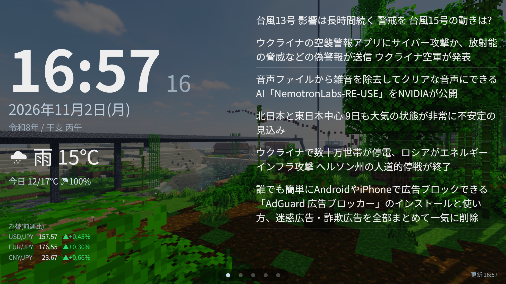

# 📡Hiroba News Smart Monitor

リアルタイムで天気・ニュースを表示する、
超軽量ローカル Web ダッシュボードです。  



> **v3.0 で設定方法・画面構成が大きく変わりました。**
> v1.x / v2.x の情報（コマンドライン引数・旧UIの機能詳細など）は **[README_old.md](./README_old.md)** を参照してください。
> v2.x からの移行は、このREADMEの[「v2.x からの移行」](#v2x-からの移行)にまとめています。

---

## ファイル構成

```
./
├── run.py          # バックエンドサーバー
├── index.html      # フロントエンド
├── config.toml     # 設定ファイル（すべての設定はここ）
├── README.md       # このファイル
├── README_old.md   # v1.x / v2.x の情報
├── images/         # 背景画像フォルダ（任意・フォルダ名は設定で変更可）
│  ├── photo1.jpg
│  ├── photo2.png
│  └── ...
└── music/          # 音楽フォルダ（任意・フォルダ名は設定で変更可）
    ├── music1.mp3
    ├── music2.ogg
    └── ...
```

---

## 起動方法

```
python run.py
```
または、
```
python3 run.py
```

ブラウザで `localhost:8765` を開くと表示されます。

> コマンドライン引数は廃止されました。
> 設定はすべて `run.py` と同じフォルダの `config.toml` に書きます。
> 設定を変更したら `run.py` を再起動してください（ブラウザの再読み込みだけでは反映されません）。

---

## 操作方法

| 操作 | 動作 |
|------|------|
| 左右スワイプ / マウスの横ドラッグ / `←` `→` キー | ページ移動 |
| 画面下のドットをタップ | そのページへ移動 |
| 縦ドラッグ（マウス）・縦スワイプ（タッチ） | ニュース・曲一覧などのスクロール |
| **最後のページより右へ**移動 | ページをリロード |
| **最初のページより左へ**移動 | 全画面を解除 |
| 画面をタップ | 全画面にする（`fullscreen_on_tap`） |
| 一定時間操作しない | ホームに戻る（`idle_return_sec`。音楽再生中は戻らない） |

> リロードすると音楽の再生は止まります。
> 「最後のページより右へ」「最初のページより左へ」は、矢印キー・マウスドラッグ・スワイプのいずれでも有効です。画面下のドットには表示されません。

---

## 設定（config.toml）

`config.toml` にすべての設定があります。各項目にはコメントが付いています。
値を省略した項目は、下表の既定値になります。

### `[server]`

| キー | 既定値 | 説明 |
|------|--------|------|
| `host` | `"localhost"` | 待ち受けアドレス。同じネットワークの別端末（タブレットなど）から見る場合は `"0.0.0.0"` |
| `port` | `8765` | ポート番号 |

### `[display]`

| キー | 既定値 | 説明 |
|------|--------|------|
| `pages` | `["home", "weather", "news", "music", "command"]` | 表示するページと並び順。書かなかったページは非表示 |
| `show_seconds` | `true` | 時計の秒表示（ホームを見ている間だけ1秒ごとに更新） |
| `idle_return_sec` | `120` | 操作がないときホームに戻るまでの秒数（`0` で戻らない） |
| `hide_cursor` | `false` | マウスカーソルを隠す（タッチパネル端末向け） |
| `fullscreen_on_tap` | `true` | 画面タップで全画面にする |
| `wake_lock` | `true` | 画面が暗くなるのを Wake Lock API で防ぐ（Chrome系。`https` か `localhost` のときのみ有効） |

`pages` の例：音楽とコマンドだけを使う場合は `pages = ["music", "command"]`

### `[background]`

| キー | 既定値 | 説明 |
|------|--------|------|
| `dir` | `"images"` | 背景画像フォルダ。空文字 `""` で背景なし |
| `interval_sec` | `30` | 切り替え間隔（秒）。`0` で切り替えず1枚だけ表示 |
| `dim` | `0.55` | 暗幕の濃さ（`0`〜`0.95`）。文字の読みやすさに影響 |

### `[location]`

| キー | 既定値 | 説明 |
|------|--------|------|
| `name` | `"東京"` | 天気ページに表示する地名 |
| `lat` | `35.6895` | 緯度 |
| `lon` | `139.6917` | 経度 |
| `timezone` | `"Asia/Tokyo"` | タイムゾーン |

### `[weather]` / `[fx]` / `[news]` / `[music]`

| セクション | キー | 既定値 | 説明 |
|-----------|------|--------|------|
| `[weather]` | `refresh_min` | `30` | 天気の更新間隔（分） |
| `[fx]` | `pairs` | `["usd", "eur", "cny"]` | 為替（対円）の通貨コード。`[]` で非表示 |
| `[fx]` | `refresh_min` | `60` | 為替の更新間隔（分） |
| `[news]` | `feeds` | NHK主要（RSS） | RSS / Atom の URL を並べる。複数書くと交互に並ぶ |
| `[news]` | `count` | `20` | ニュースページの最大件数 |
| `[news]` | `home_count` | `6` | ホームに出す見出しの上限件数 |
| `[news]` | `refresh_min` | `10` | ニュースの更新間隔（分） |
| `[music]` | `dir` | `"music"` | 音楽フォルダ。空文字 `""` で無効 |
| `[music]` | `volume` | `0.8` | 起動時の音量（`0`〜`1`） |
| `[music]` | `mode` | `"seq"` | 再生モード。`"seq"` 順番 / `"rand"` ランダム / `"one"` 1曲リピート |

### `[[commands]]`（コマンドページのボタン）

上から順にボタンとして並びます。

| キー | 説明 |
|------|------|
| `name` | ボタンに表示する名前 |
| `cmd` | 文字列ならシェル経由で実行。`["プログラム", "引数", ...]` の配列なら、シェルを通さず直接実行 |
| `confirm` | `true` にすると「もう一度タップで実行」の確認が入る（再起動など誤タップが困るもの向け） |

```toml
[[commands]]
name = "画面輝度を最大にする(Linux)"
cmd = ["brightnessctl", "set", "255"]

[[commands]]
name = "再起動(Linux)"
cmd = ["systemctl", "reboot"]
confirm = true
```

Windows のパスなど、バックスラッシュが多い文字列は `'...'`（シングルクォート）で囲むと書きやすくなります。

### 設定例

```toml
# 大阪・ポート8080・ホームと天気だけ表示・タッチパネル端末向け
[server]
port = 8080

[display]
pages = ["home", "weather"]
hide_cursor = true      # カーソル非表示
wake_lock = true        # 画面が暗くなるのを防止するよう試行

[location]
name = "大阪"
lat = 34.6937
lon = 135.5023

# RSSフィードを独自のものにする
[news]
feeds = [
  "https://example.com/feed.xml",
]
```

> 同じセクション（`[display]` など）は1か所にまとめて書いてください。

### 主要都市の緯度経度

| 都市 | `lat` | `lon` |
|------|-------|-------|
| 札幌 | 43.0618 | 141.3545 |
| 仙台 | 38.2682 | 140.8694 |
| 東京 | 35.6895 | 139.6917 |
| 横浜 | 35.4478 | 139.6425 |
| 名古屋 | 35.1815 | 136.9066 |
| 京都 | 35.0116 | 135.7681 |
| 大阪 | 34.6937 | 135.5023 |
| 神戸 | 34.6913 | 135.1830 |
| 広島 | 34.3963 | 132.4596 |
| 今治 | 34.0664 | 133.0077 |
| 高松 | 34.3401 | 134.0434 |
| 福岡 | 33.5904 | 130.4017 |
| 那覇 | 26.2124 | 127.6809 |

> **Google Maps** で右クリック → 座標を取得可能

---

## 機能詳細

画面は左右に並んだ5ページです。`pages` で表示するページと順番を変えられます。

### 🏠 ホーム（`home`）
- 時計（24時間表記）。秒表示はホームを見ている間だけ更新
- 西暦・曜日、和暦（令和）・干支（例：丙午）
- 現在の天気と、今日の最低/最高気温・降水確率
- ニュース見出し（右側）。枠に収まらない見出しは自動的に非表示
- 為替レート（左下）。USD/JPY・EUR/JPY・CNY/JPY と前週比。上昇：緑、下落：赤

### 🌤 天気（`weather`）
- **気象データ：** [Open-Meteo API](https://open-meteo.com/)
- 現在の気温・体感温度・湿度・風速・日の出/日の入
- 2時間刻みの時間予報（12コマ）と降水確率
- 7日間の週間予報（最高/最低気温・降水確率）
- **更新間隔：** 既定30分

### 📰 ニュース（`news`）
- `config.toml` の `feeds` に書いた RSS / Atom の見出しを、フィードを交互に並べて表示
- 見出しをタップすると概要と「記事を開く」リンクを展開（別の見出しをタップすると閉じる）
- **更新間隔：** 既定10分

### 🎵 音楽（`music`）
- `music` フォルダ以下を読み込み（`.mp3` `.flac` `.wav` `.ogg` `.m4a` `.aac` `.opus`）
- フォルダを辿って曲を選択。**開いているフォルダ以下**（サブフォルダ含む）が再生範囲になる
- 再生/一時停止、前の曲/次の曲、シークバー、音量スライダー
- モード切替：順番 / ランダム / 1曲リピート
- 順番再生で最後まで行くと、同じフォルダの先頭に戻る
- 再生できない曲は自動でスキップ

### 📱 コマンド（`command`）
- `config.toml` の `[[commands]]` で定義したコマンドをタップで実行
- `confirm = true` のコマンドは、もう一度タップしたときに実行（4秒で解除）
- 連続実行を防ぐため、実行後2秒はボタンを押せない
- **実行できるのは `config.toml` に書いたコマンドだけ**（画面からは番号で呼び出すため、任意のコマンドは送れません）

### 🖼 背景画像
- `images/` フォルダに画像を置くと自動認識（追加・削除は、全画像を使い切って一覧を取り直した時点で反映）
- 対応形式：`.jpg` `.jpeg` `.png` `.webp` `.gif` `.avif`
- 既定では**30秒ごと**に切り替わる（1秒クロスフェード）。全画像を使い切るまで同じ画像は出ない
- フォルダが空でも問題なし（暗い背景で動作）
- 解像度が高いほど消費電力が増えます。画面サイズ程度に縮小した画像を推奨します

---

## 低消費電力のための設計

- ぼかし・影・Webフォント・常時アニメーションを使わない（動くのは背景のフェードとページ移動のみ）
- **表示中のページに必要なデータだけ**を取得する（見ていないページは取りに行かない）
- 画面が非表示の間は、時計・背景切り替え・データ取得を止める
- 時計は通常1分ごとの更新。秒更新はホームを見ている間だけ（`show_seconds = false` で無効化も可）
- 音楽ページを見ていない間は、再生バーなどを描画しない
- サーバーは常駐スレッドを持たず、要求があったときだけ外部APIを取得する

---

## データキャッシュ

サーバー側で取得データをキャッシュしています（既定：天気30分・ニュース10分・為替60分）。  
複数タブ・デバイスから同時に開いても外部APIへの負荷がかかりません。  
取得に失敗した場合は前回の値を保持して表示し、60秒後に再試行します。

> 為替は currency-api（ECBベースの日次レート）のため、分単位のリアルタイム更新ではありません。土日は前営業日の値になります。

---

## 注意事項

- `host = "0.0.0.0"` にすると同じネットワークのどの端末からでも見られますが、**コマンドページも誰でも操作できる状態**になります。再起動など危険なコマンドには `confirm = true` を付けてください
- Wake Lock は `https` または `localhost` で開いたときだけ有効です。`http://192.168.x.x` のように IP アドレスで開いた場合は効きません
- 他サイトのページからコマンドが勝手に実行されないよう、Origin を検証しています（`localhost` 待ち受け時は Host ヘッダーも検証）

---

## 動作要件

- **Python：** 3.8 以上
- **外部ライブラリ：** 不要（標準ライブラリのみ。Python 3.11 未満では簡易TOMLパーサーが自動で使われます）
- **ネットワーク：** HTTP アクセスが必要

---

## v2.x からの移行

v2.x まではコマンドライン引数で設定していましたが、v3.0 では `config.toml` に統合されました。

| v2.x | v3.0 |
|------|------|
| `--city` | `[location]` の `name` |
| `--lat` / `--lon` | `[location]` の `lat` / `lon` |
| `--port` | `[server]` の `port` |
| `--rss URL ...` | `[news]` の `feeds` に URL を追加 |
| `--no-default-rss` | `feeds` に使いたいものだけを書く |
| `--compact-clock` | 廃止（画面サイズに合わせて自動調整） |
| `--compact-news` | 廃止（ニュースは常にタップで展開） |
| `--mouse-hide` | `[display]` の `hide_cursor = true` |
| `--wake-lock` | `[display]` の `wake_lock = true` |
| `--disable-ticker` | 廃止（LIVE NEWS 自体を廃止） |
| `--disable-slides N` | `[display]` の `pages`（残したいページだけ書く） |
| `commands.json` | `config.toml` の `[[commands]]` |

---

## 更新履歴

### v3.0
**画面・UI**
- UIを全面的に刷新し、軽量化（ぼかし・影・Webフォント・常時アニメーションを廃止）
- 画面を「ホーム・天気・ニュース・音楽・コマンド」の5ページに再構成。`pages` で各ページの表示/非表示と並び順を指定可能
- ホームを情報量を絞った構成に変更（時計・和暦/干支・現在の天気と今日の予報・ニュース見出し・為替）
- 為替をホームの左下に小さく表示
- ページ移動：スワイプ・マウスドラッグ・矢印キーに対応。最後のページより右へ移動でリロード、最初のページより左へ移動で全画面解除
- 一定時間操作がなければホームに戻る機能（`idle_return_sec`）を追加
- ニュース：見出しをタップして概要とリンクを展開する方式に統一。ホームの見出しは収まる分だけ表示
- 音楽：フォルダを辿る方式に変更し、開いているフォルダ以下が再生範囲に。順番再生で最後まで行くと同じフォルダの先頭に戻る
- コマンド：`confirm` による2回タップ確認を追加

**設定・内部**
- **設定を `config.toml` に統合し、コマンドライン引数と `commands.json` を廃止**
- コマンドは設定ファイルにあるものだけ実行（画面からは番号で指定）。他サイトからの実行を防ぐ検証を追加
- サーバー側の取得処理を整理（失敗時は前回値を保持）。表示中のページ分だけ取得。音楽・画像をチャンク配信
- 音楽の配信をマルチスレッド化し、曲の再生中も他の画面が止まらないように変更
- 待ち受けの既定を `localhost:8765` に

**廃止**
- LIVE NEWS ティッカー、防災バナー、リロード用スライド
- 2枚目の時計＋天気の専用ページ（時計はホームに統合）
- 天気の日別タブ、降水量(mm)表示（降水確率に変更）
- ニュースのタイル表示、発行日時表示
- 音楽の「範囲限定」チェックボックス、音量の＋/－ボタン
- 6時間ごとの自動リロード
- `--compact-clock` `--compact-news` `--disable-ticker` `--disable-slides` ほか全コマンドライン引数

> v1.x / v2.x の機能詳細・引数一覧は [README_old.md](./README_old.md) を参照してください。

### v2.0
- 複数ページ化
- 時間+天気の専用ページを追加
- ニュースの専用ページを追加
- 音楽再生機能を追加
- コマンド実行機能を追加
- リロードを6時間おきから手動へ変更

### v1.1
- `--compact-clock` 追加：時計フォントを縮小表示（Linux環境などで右端にはみ出る場合に有効）
- `--compact-news` 追加：ニュースをタイトルのみ表示し、タップで詳細と記事リンクを展開するモード
- `--mouse-hide` 追加：マウスカーソルを非表示にする（タッチパネル端末向け）
- `--wake-lock` 追加：画面が暗くなるのをWakeLockAPIを利用し阻止するよう試行する（Chrome系ブラウザ向け）
- マウスドラッグ・タッチスワイプによるスクロール対応（ニュースエリア・時間予報・週間予報）
- 今日の時間別天気を週間予報エリアから独立したパネルに分離
- ティッカー（上部ニュース帯）のクリックを無効化
- 防災バナーのアイテムクリックを無効化

### v1.0
- 初回リリース

---

## ライセンス

MIT License — 自由に改変・再配布できます。
